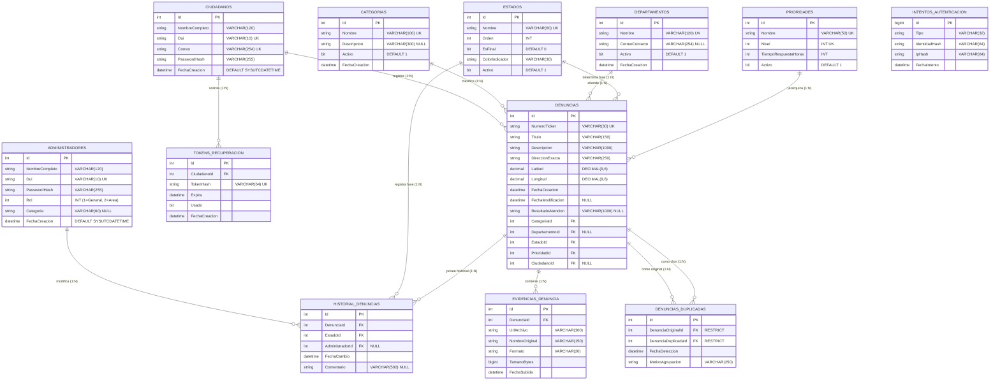

# DOCUMENTO DE ARQUITECTURA EMPRESARIAL Y DISEÑO DE BASE DE DATOS
## ETAPA 3: PERSISTENCIA DE DATOS Y ARQUITECTURA EMPRESARIAL (25%)

**Universidad Don Bosco**  
**Facultad de Estudios Tecnológicos / Escuela de Computación**  
**Asignatura:** Desarrollo de Aplicaciones con Software Propietario  
**Proyecto Integrador:** Sistema Web de Gestión de Denuncias Ciudadanas de Soyapango  
**Docente:** Ing. Gerardo Enrique Ponce Coreas  
**Ciclo Académico:** II-2026  

---

### Equipo de Desarrollo y Distribución de Responsabilidades:
* **Persona 1 (Proyecto, Usuarios y Seguridad):** José Arnulfo Rauda Ramírez (Carnet: RR230462)
* **Persona 2 (Catálogos, Capa Base y Documentación):** Steven Alejandro Ayala Aparicio (Carnet: AA220466)
* **Persona 3 (Denuncias, Administración y Reportes):** Asael Enrique Lopez Ramirez (Carnet: LR260119)

---

## 1. DISEÑO DE LA BASE DE DATOS RELACIONAL (12 TABLAS)

### 1.1 Identificación de Entidades del Dominio
El modelo de datos relacional para la Alcaldía Municipal de Soyapango se compone de **12 entidades**, organizadas modularmente según las tres áreas del sistema:

1. **Módulo de Usuarios, Seguridad y Auditoría (Persona 1):**
   * `Ciudadanos`: Registra a los habitantes del municipio con DUI y correo único, junto con su credencial hasheada mediante `PasswordHasher`.
   * `Administradores`: Empleados municipales de atención ciudadana clasificados como Administrador General (superusuario) o Administrador de Área (asociado a una categoría específica).
   * `TokensRecuperacion`: Tokens de un solo uso protegidos con SHA-256 para restablecimiento de contraseñas con expiración controlada de 30 minutos.
   * `IntentosAutenticacion`: Registro de auditoría y mitigación de fuerza bruta con anonimización (hashes SHA-256 de DUI e IP) y bloqueo temporal tras 5 fallos en 15 minutos.

2. **Módulo de Catálogos y Parametrización (Persona 2):**
   * `Categorias`: Catálogo maestro de incidentes urbanos reportables (Bacheo, Desechos sólidos, Chapoda y Áreas Verdes, Obstrucción de vía, Luminaria dañada, Otro).
   * `Departamentos`: Dependencias y unidades operativas de la Alcaldía de Soyapango encargadas de ejecutar los trabajos en territorio (Mantenimiento Vial, Desechos Sólidos, Alumbrado Público, etc.).
   * `Estados`: Ciclo de vida secuencial del expediente de denuncia (Recibido, En proceso, Enviado a Alcaldía, Finalizado), parametrizado con orden lógico, color institucional y marca de estado terminal (`EsFinal`).
   * `Prioridades`: Jerarquía técnica de urgencia (Común, Urgente, Súper urgente) con SLA máximo de respuesta en horas (72h, 48h, 24h).

3. **Módulo de Denuncias, Trazabilidad y Evidencias (Persona 3):**
   * `Denuncias`: Entidad medular del sistema donde se almacena el código de ticket único (`SOY-2026-XXXXXX`), geolocalización (latitud, longitud, dirección exacta), descripción y llaves foráneas a los catálogos y al ciudadano denunciante.
   * `HistorialDenuncias`: Pistas de auditoría y trazabilidad histórica de todos los cambios de estado, asignación de departamento o modificaciones sufridas por un expediente.
   * `EvidenciasDenuncia`: Almacenamiento de fotografías y evidencias adjuntas en el servidor local (`wwwroot/uploads`) con metadatos técnicos y marcas de tiempo.
   * `DenunciasDuplicadas`: Vinculación jerárquica de denuncias repetidas sobre un mismo incidente detectadas por cercanía geográfica y temporal, configurada con `DeleteBehavior.Restrict` en ambas direcciones.

---

### 1.2 Relaciones entre Entidades y Restricciones Referenciales

* **`Ciudadanos` 1:N `Denuncias`:** Un habitante puede registrar múltiples denuncias a lo largo del tiempo. `CiudadanoId` en `Denuncias` es opcional/anulable para permitir registros directos por personal de la municipalidad.
* **`Ciudadanos` 1:N `TokensRecuperacion`:** Un ciudadano puede generar solicitudes de recuperación de acceso. Al eliminar un ciudadano, sus tokens se purgan en cascada (`OnDelete: Cascade`).
* **`Categorias` 1:N `Denuncias`:** Cada denuncia está tipificada estrictamente bajo una categoría válida. Restricción referencial protegida.
* **`Estados` 1:N `Denuncias`:** Toda denuncia posee un estado actual que rige su visualización en el sistema.
* **`Prioridades` 1:N `Denuncias`:** La denuncia tiene un nivel de prioridad asignado según criterio técnico de la jefatura.
* **`Departamentos` 1:N `Denuncias`:** Denuncia derivada a una unidad operativa ejecutora.
* **`Denuncias` 1:N `HistorialDenuncias`:** Cada vez que una denuncia cambia de estado o departamento, se inserta una fila inmutable en el historial.
* **`Denuncias` 1:N `EvidenciasDenuncia`:** Una denuncia puede contener una o varias fotografías de prueba.
* **`Denuncias` 1:N `DenunciasDuplicadas` (Relación Dual Restringida):** Una denuncia marcada como original puede agrupar múltiples duplicadas. Para preservar la integridad del histórico municipal, las dos llaves foráneas (`DenunciaOriginalId` y `DenunciaDuplicadaId`) se configuran con `DeleteBehavior.Restrict`.

---

### 1.3 Modelo Entidad-Relación (Diagrama MER)



---

### 1.4 Proceso Formal de Normalización (1FN, 2FN, 3FN)

El diseño del esquema relacional fue sometido al proceso sistemático de normalización para asegurar la integridad de datos, eliminar redundancias y evitar anomalías de inserción, actualización y borrado:

#### Primera Forma Normal (1FN):
* **Condición:** Todos los atributos contienen valores atómicos indivisibles; no existen grupos repetitivos ni atributos multivaluados en una sola columna.
* **Demostración en el sistema:**
  * En la entidad `Ciudadanos`, el nombre completo y las credenciales se almacenan en columnas individuales.
  * En `Denuncias`, las coordenadas geográficas no se agruparon en un string compuesto, sino que se separaron en `Latitud` (`DECIMAL(9,6)`) y `Longitud` (`DECIMAL(9,6)`).
  * Las evidencias fotográficas no se almacenaron como cadenas delimitadas por comas (`foto1.jpg, foto2.jpg`), sino que se normalizaron extrayendo una entidad independiente `EvidenciasDenuncia` (1:N).

#### Segunda Forma Normal (2FN):
* **Condición:** Cumple 1FN y todo atributo que no forma parte de la clave primaria depende funcionalmente de manera completa de la clave primaria principal (no dependencias parciales de claves compuestas).
* **Demostración en el sistema:**
  * Todas las tablas del sistema utilizan claves primarias sintéticas simples (`Id INT IDENTITY` o `BIGINT`). Al no depender de claves compuestas complejas, se garantiza por definición matemática que cualquier atributo no clave depende funcionalmente de la totalidad de su identificador primario.

#### Tercera Forma Normal (3FN):
* **Condición:** Cumple 2FN y ningún atributo no clave depende transitivamente de otro atributo no clave (eliminación de dependencias transitivas: si $A \rightarrow B$ y $B \rightarrow C$, entonces $C$ debe vivir en una tabla aparte).
* **Demostración en el sistema:**
  * En el prototipo inicial, la denuncia pretendía almacenar el nombre del departamento ejecutor, el correo del jefe de cuadrilla y los días de respuesta. Esto violaba 3FN porque el correo del departamento dependía del departamento y no directamente de la denuncia. Se crearon los catálogos normalizados `Departamentos`, `Categorias`, `Estados` y `Prioridades`. En la tabla `Denuncias` únicamente residen las llaves foráneas (`CategoriaId`, `DepartamentoId`, `EstadoId`, `PrioridadId`), desacoplando la metadata del catálogo de la transacción del reporte.

---

### 1.5 Diccionario de Datos Completo (12 Tablas)

#### Tabla 1: `Ciudadanos`
| Columna | Tipo de Dato SQL | Long. | Nulo | Clave | Default | Descripción / Restricciones |
|---|---|---|---|---|---|---|
| `Id` | INT | 4 | No | PK | IDENTITY | Identificador único del ciudadano. |
| `NombreCompleto` | NVARCHAR | 120 | No | - | - | Nombre y apellido del habitante. |
| `Dui` | VARCHAR | 10 | No | UK | - | DUI formato salvadoreño `00000000-0`. Índice único. |
| `Correo` | NVARCHAR | 254 | No | UK | - | Correo electrónico de contacto. Índice único. |
| `PasswordHash` | NVARCHAR | 255 | No | - | - | Hash criptográfico generado con `PasswordHasher<T>`. |
| `FechaCreacion` | DATETIME2 | 7 | No | - | SYSUTCDATETIME() | Fecha de registro en la plataforma (UTC). |

#### Tabla 2: `Administradores`
| Columna | Tipo de Dato SQL | Long. | Nulo | Clave | Default | Descripción / Restricciones |
|---|---|---|---|---|---|---|
| `Id` | INT | 4 | No | PK | IDENTITY | Identificador único del funcionario administrativo. |
| `NombreCompleto` | NVARCHAR | 120 | No | - | - | Nombre del empleado municipal. |
| `Dui` | VARCHAR | 10 | No | UK | - | Documento de identidad del administrador. |
| `PasswordHash` | NVARCHAR | 255 | No | - | - | Hash seguro de acceso. |
| `Rol` | INT | 4 | No | - | - | Enum: `1 = General` (SuperAdmin), `2 = Area` (Operativo). |
| `Categoria` | NVARCHAR | 60 | Sí | - | NULL | Área asignada. Check: Obligatorio si Rol=2; NULL si Rol=1. |
| `FechaCreacion` | DATETIME2 | 7 | No | - | SYSUTCDATETIME() | Fecha de alta en el sistema. |

#### Tabla 3: `TokensRecuperacion`
| Columna | Tipo de Dato SQL | Long. | Nulo | Clave | Default | Descripción / Restricciones |
|---|---|---|---|---|---|---|
| `Id` | INT | 4 | No | PK | IDENTITY | Identificador de la solicitud de cambio de clave. |
| `CiudadanoId` | INT | 4 | No | FK | - | Referencia a `Ciudadanos(Id)`. Borrado en Cascada. |
| `TokenHash` | VARCHAR | 64 | No | UK | - | Hash SHA-256 del token aleatorio entregado al usuario. |
| `Expira` | DATETIME2 | 7 | No | - | - | Tiempo límite de vida del token (30 minutos). |
| `Usado` | BIT | 1 | No | - | 0 | Bandera: `1` si el token ya fue consumido. |
| `FechaCreacion` | DATETIME2 | 7 | No | - | SYSUTCDATETIME() | Marca temporal de expedición. |

#### Tabla 4: `IntentosAutenticacion`
| Columna | Tipo de Dato SQL | Long. | Nulo | Clave | Default | Descripción / Restricciones |
|---|---|---|---|---|---|---|
| `Id` | BIGINT | 8 | No | PK | IDENTITY | Identificador correlativo del intento. |
| `Tipo` | VARCHAR | 32 | No | - | - | `ciudadano_login` o `admin_login`. |
| `IdentidadHash` | VARCHAR | 64 | No | - | - | Hash SHA-256 del DUI intentado (anonimizado). |
| `IpHash` | VARCHAR | 64 | No | - | - | Hash SHA-256 de la dirección IP de origen. |
| `FechaIntento` | DATETIME2 | 7 | No | - | SYSUTCDATETIME() | Fecha y hora exacta del intento. |

#### Tabla 5: `Categorias`
| Columna | Tipo de Dato SQL | Long. | Nulo | Clave | Default | Descripción / Restricciones |
|---|---|---|---|---|---|---|
| `Id` | INT | 4 | No | PK | IDENTITY | Identificador de la categoría. |
| `Nombre` | NVARCHAR | 100 | No | UK | - | Nombre del tipo de problema (Bacheo, Basura, etc.). |
| `Descripcion` | NVARCHAR | 300 | Sí | - | NULL | Detalle o instrucciones del tipo de denuncia. |
| `Activo` | BIT | 1 | No | - | 1 | Estado lógico: `1 = Activo`, `0 = Desactivado`. |
| `FechaCreacion` | DATETIME2 | 7 | No | - | SYSUTCDATETIME() | Fecha de registro. |

#### Tabla 6: `Departamentos`
| Columna | Tipo de Dato SQL | Long. | Nulo | Clave | Default | Descripción / Restricciones |
|---|---|---|---|---|---|---|
| `Id` | INT | 4 | No | PK | IDENTITY | Identificador de la dependencia municipal. |
| `Nombre` | NVARCHAR | 120 | No | UK | - | Nombre de la gerencia o unidad operativa. |
| `CorreoContacto` | NVARCHAR | 254 | Sí | - | NULL | Correo de notificación institucional. |
| `Activo` | BIT | 1 | No | - | 1 | Estado lógico del departamento. |
| `FechaCreacion` | DATETIME2 | 7 | No | - | SYSUTCDATETIME() | Fecha de registro. |

#### Tabla 7: `Estados`
| Columna | Tipo de Dato SQL | Long. | Nulo | Clave | Default | Descripción / Restricciones |
|---|---|---|---|---|---|---|
| `Id` | INT | 4 | No | PK | IDENTITY | Identificador del estado. |
| `Nombre` | NVARCHAR | 60 | No | UK | - | Nombre del estado (Recibido, En proceso, etc.). |
| `Orden` | INT | 4 | No | - | - | Posición en la línea de tiempo (1, 2, 3, 4). |
| `EsFinal` | BIT | 1 | No | - | 0 | `1` si representa la culminación del trámite. |
| `ColorIndicador` | NVARCHAR | 30 | No | - | - | Etiqueta de color (Naranja, Verde, Azul, Gris). |
| `Activo` | BIT | 1 | No | - | 1 | Disponibilidad en el catálogo. |

#### Tabla 8: `Prioridades`
| Columna | Tipo de Dato SQL | Long. | Nulo | Clave | Default | Descripción / Restricciones |
|---|---|---|---|---|---|---|
| `Id` | INT | 4 | No | PK | IDENTITY | Identificador de la prioridad. |
| `Nombre` | NVARCHAR | 50 | No | UK | - | Nivel legible (Común, Urgente, Súper urgente). |
| `Nivel` | INT | 4 | No | UK | - | Jerarquía numérica (1=Común, 2=Urgente, 3=Súper). |
| `TiempoRespuestaHoras` | INT | 4 | No | - | - | Plazo contractual SLA para atención en campo. |
| `Activo` | BIT | 1 | No | - | 1 | Disponibilidad en el catálogo. |

#### Tabla 9: `Denuncias`
| Columna | Tipo de Dato SQL | Long. | Nulo | Clave | Default | Descripción / Restricciones |
|---|---|---|---|---|---|---|
| `Id` | INT | 4 | No | PK | IDENTITY | Identificador numérico interno de la denuncia. |
| `NumeroTicket` | VARCHAR | 30 | No | UK | - | Formato `SOY-YYYY-000000`. Índice único. |
| `Titulo` | NVARCHAR | 150 | No | - | - | Breve resumen del incidente reportado. |
| `Descripcion` | NVARCHAR | 1000 | No | - | - | Detalle completo de la situación. |
| `DireccionExacta` | NVARCHAR | 250 | No | - | - | Dirección domiciliaria, colonia o punto de referencia. |
| `Latitud` | DECIMAL(9,6) | 9 | No | - | - | Coordenada GPS de latitud en Soyapango. |
| `Longitud` | DECIMAL(9,6) | 9 | No | - | - | Coordenada GPS de longitud en Soyapango. |
| `FechaCreacion` | DATETIME2 | 7 | No | - | SYSUTCDATETIME() | Fecha y hora en que se ingresó el reporte. |
| `FechaModificacion` | DATETIME2 | 7 | Sí | - | NULL | Última fecha en que se actualizó el registro. |
| `ResultadoAtencion` | NVARCHAR | 1000 | Sí | - | NULL | Conclusión y detalle de la obra ejecutada. |
| `CategoriaId` | INT | 4 | No | FK | - | FK a `Categorias(Id)`. |
| `DepartamentoId` | INT | 4 | Sí | FK | NULL | FK a `Departamentos(Id)`. |
| `EstadoId` | INT | 4 | No | FK | - | FK a `Estados(Id)`. |
| `PrioridadId` | INT | 4 | No | FK | - | FK a `Prioridades(Id)`. |
| `CiudadanoId` | INT | 4 | Sí | FK | NULL | FK a `Ciudadanos(Id)`. NULL si lo crea admin. |

#### Tabla 10: `HistorialDenuncias`
| Columna | Tipo de Dato SQL | Long. | Nulo | Clave | Default | Descripción / Restricciones |
|---|---|---|---|---|---|---|
| `Id` | INT | 4 | No | PK | IDENTITY | Identificador correlativo del cambio histórico. |
| `DenunciaId` | INT | 4 | No | FK | - | FK a `Denuncias(Id)`. Borrado en Cascada. |
| `EstadoId` | INT | 4 | No | FK | - | FK a `Estados(Id)` en el momento del cambio. |
| `AdministradorId` | INT | 4 | Sí | FK | NULL | FK a `Administradores(Id)` autor de la acción. |
| `FechaCambio` | DATETIME2 | 7 | No | - | SYSUTCDATETIME() | Momento exacto de la transición de estado. |
| `Comentario` | NVARCHAR | 500 | Sí | - | NULL | Observaciones técnicas o motivo del cambio. |

#### Tabla 11: `EvidenciasDenuncia`
| Columna | Tipo de Dato SQL | Long. | Nulo | Clave | Default | Descripción / Restricciones |
|---|---|---|---|---|---|---|
| `Id` | INT | 4 | No | PK | IDENTITY | Identificador de la evidencia gráfica. |
| `DenunciaId` | INT | 4 | No | FK | - | FK a `Denuncias(Id)`. Borrado en Cascada. |
| `UrlArchivo` | NVARCHAR | 300 | No | - | - | Ruta relativa persistida en servidor (`/uploads/...`). |
| `NombreOriginal` | NVARCHAR | 150 | No | - | - | Nombre original del archivo subido por el usuario. |
| `Formato` | VARCHAR | 20 | No | - | - | Extensión MIME (image/jpeg, image/png). |
| `TamanoBytes` | BIGINT | 8 | No | - | - | Peso del archivo para control de cuota. |
| `FechaSubida` | DATETIME2 | 7 | No | - | SYSUTCDATETIME() | Fecha y hora de almacenamiento. |

#### Tabla 12: `DenunciasDuplicadas`
| Columna | Tipo de Dato SQL | Long. | Nulo | Clave | Default | Descripción / Restricciones |
|---|---|---|---|---|---|---|
| `Id` | INT | 4 | No | PK | IDENTITY | Identificador del vínculo de duplicidad. |
| `DenunciaOriginalId`| INT | 4 | No | FK | - | FK a `Denuncias(Id)` matriz (`DeleteBehavior.Restrict`). |
| `DenunciaDuplicadaId`| INT | 4 | No | FK | - | FK a `Denuncias(Id)` clon (`DeleteBehavior.Restrict`). |
| `FechaDeteccion` | DATETIME2 | 7 | No | - | SYSUTCDATETIME() | Momento en que se asoció como duplicado. |
| `MotivoAgrupacion` | NVARCHAR | 250 | No | - | - | Razón (Misma coordenada GPS o misma cuadra). |

---

## 2. ARQUITECTURA LIMPIA Y PRINCIPIOS SOLID

### 2.1 Modelo Multicapa (Clean Architecture / N-Capas)

La solución adopta una arquitectura orientada al dominio y desacoplada mediante abstracciones. El flujo unidireccional de responsabilidades se distribuye en:

```
[ Capa de Presentación (UI / MVC) ]
      │
      ▼
[ Capa de Lógica de Negocio y Aplicación (Services / DTOs) ]
      │
      ▼
[ Capa de Dominio y Contratos (Models / Interfaces) ]
      │
      ▼
[ Capa de Infraestructura y Datos (Repositories / UnitOfWork / EF Core DbContext) ]
      │
      ▼
[ Motor de Base de Datos (SQL Server LocalDB) ]
```

1. **Capa de Presentación:** Controladores MVC (`CatalogosController`, `AdminController`, `CiudadanoController`, `AccountController`), vistas Razor tipadas y ViewModels especializados que previenen sobreexposición de datos.
2. **Capa de Lógica de Negocio (Servicios):** Implementada a través de contratos (`ICatalogoService`, `IAuthService`, `IDenunciaService`). Contiene validaciones funcionales, reglas de negocio y orquestación de operaciones complejas.
3. **Capa de Acceso a Datos (Repositorios y Unit of Work):** Encapsula el acceso al `ApplicationDbContext` mediante `IRepository<T>`, `Repository<T>` y `IUnitOfWork`. Oculta los detalles técnicos del ORM a las capas superiores.
4. **Capa de Persistencia (EF Core y SQL Server):** Configuración declarativa mediante clases Fluent API (`IEntityTypeConfiguration<T>`), migración controlada y semillas de datos (`DbSeeder`).

---

### 2.2 Patrón Repositorio y Patrón Unidad de Trabajo (Unit of Work)

* **Propósito del Repositorio (`IRepository<T>`):** Proporciona una colección en memoria virtualizada de las entidades de la base de datos. Centraliza las operaciones CRUD (`ObtenerPorIdAsync`, `BuscarAsync`, `AgregarAsync`, `Actualizar`, `Eliminar`) aplicando consultas optimizadas con `.AsNoTracking()` para lecturas no mutables.
* **Propósito de la Unidad de Trabajo (`IUnitOfWork`):** Coordina los cambios realizados por múltiples repositorios dentro de un solo contexto de transacción de base de datos. Cuenta con el método `CommitAsync()` (`SaveChangesAsync()`) y control explícito de transacciones ACID (`BeginTransactionAsync`, `CommitTransactionAsync`, `RollbackTransactionAsync`). Evita llamadas fragmentadas a la base de datos y garantiza que o se guardan todas las operaciones o no se guarda ninguna.

---

### 2.3 Aplicación Estratégica de los Principios SOLID

| Principio | Nombre | Aplicación en la Solución de Soyapango |
|---|---|---|
| **S** | **Single Responsibility Principle (SRP)** | Cada clase u objeto tiene un único motivo para cambiar. Por ejemplo, `CatalogoService` se encarga exclusivamente de las reglas y validaciones de catálogos municipales; `AuthService` gestiona la autenticación, tokens y hashes; y los repositorios se limitan exclusivamente al acceso y consulta a la base de datos sin contaminarse con lógica de vistas. |
| **O** | **Open/Closed Principle (OCP)** | Las entidades y la infraestructura están abiertas para la extensión pero cerradas para la modificación. La interfaz genérica `IRepository<T>` permite soportar cualquier nueva entidad del sistema (como las de Persona 3) sin alterar la clase base `Repository<T>`. Del mismo modo, el DbContext utiliza `ApplyConfigurationsFromAssembly`, lo que permite agregar nuevas configuraciones Fluent API sin modificar `ApplicationDbContext.cs`. |
| **L** | **Liskov Substitution Principle (LSP)** | Las clases derivadas pueden sustituir a sus abstracciones base sin alterar el comportamiento del sistema. Cualquier componente que dependa de `IRepository<Categoria>` o `IUnitOfWork` puede recibir tanto la implementación real basada en Entity Framework Core como una implementación simulada (Mock en memoria) para pruebas unitarias sin que el código de negocio sufra fallas. |
| **I** | **Interface Segregation Principle (ISP)** | Se definieron contratos pequeños, cohesivos y orientados a tareas específicas en lugar de interfaces monolíticas. Un controlador solo inyecta la interfaz que realmente consume: `CatalogosController` consume `ICatalogoService`; `AccountController` consume `IAuthService`; y los servicios interactúan únicamente con las propiedades de repositorios expuestas por `IUnitOfWork`. |
| **D** | **Dependency Inversion Principle (DIP)** | Los módulos de alto nivel (controladores y servicios) no dependen de módulos de bajo nivel (clases concretas de EF Core o SQL Server), sino de abstracciones (interfaces). Todas las dependencias se inyectan a través del constructor mediante el contenedor de inversión de control de ASP.NET Core (`Program.cs`) con ciclo de vida `Scoped`. |

---

## 3. GUÍA DE CONTROL DE VERSIONES GIT Y RAMAS (CRITERIO 9)

Para garantizar un flujo colaborativo profesional conforme a GitFlow y al criterio 9 de la rúbrica, se definen las ramas y los mensajes de commit estructurados:

### 3.1 Estructura de Ramas
* `main`: Código de producción completamente probado y estable.
* `dev`: Rama de integración donde convergen los módulos de los tres integrantes.
* `feature/catalogos-capabase`: Rama de trabajo individual de Persona 2.

### 3.2 Secuencia de Comandos y Commits de Persona 2
```bash
# 1. Crear e ingresar a la rama de Persona 2
git checkout -b feature/catalogos-capabase dev

# 2. Commit de Entidades y Modelos de Catálogos
git add Models/Categoria.cs Models/Departamento.cs Models/Estado.cs Models/Prioridad.cs
git commit -m "feat(modelos): agregar entidades Categoria, Departamento, Estado y Prioridad"

# 3. Commit de Configuraciones Fluent API y Contexto EF Core
git add Data/Configurations/ Data/ApplicationDbContext.cs
git commit -m "feat(datos): configurar mapeo Fluent API con indices unicos y registrar DbSets"

# 4. Commit de Capa Base (IRepository y Unit of Work)
git add Repositories/IRepository.cs Repositories/Repository.cs Repositories/IUnitOfWork.cs Repositories/UnitOfWork.cs Program.cs
git commit -m "feat(persistencia): implementar patron Generic Repository y Unit of Work transaccional"

# 5. Commit de Servicio de Catálogos y Datos Semilla
git add Services/ICatalogoService.cs Services/CatalogoService.cs Data/DbSeeder.cs ViewModels/CatalogosViewModels.cs
git commit -m "feat(servicios): crear CatalogoService con validacion de unicidad y sembrado de datos iniciales"

# 6. Commit de Controlador y Pantalla Administrativa de Catálogos
git add Controllers/CatalogosController.cs Views/Catalogos/ Views/Shared/_AdminLayout.cshtml
git commit -m "feat(ui): implementar CRUD administrativo de catalogos municipales con validacion y estilo oficial"

# 7. Commit de Integración de Listas Desplegables en Formularios
git add Views/Ciudadano/CrearDenuncia.cshtml Views/Admin/Detalle.cshtml Views/Admin/Dashboard.cshtml Views/Admin/Mapa.cshtml
git commit -m "refactor(vistas): vincular listas desplegables y filtros dinámicos con ICatalogoService"

# 8. Commit de Documentación Técnica Formal
git add docs/
git commit -m "docs(etapa3): agregar documento tecnico formal de arquitectura y base de datos con MER y 3FN"

# 9. Subir los cambios al repositorio remoto
git push origin feature/catalogos-capabase
```

---

## 4. GUIÓN DE SUSTENTACIÓN EN VIDEO (CRITERIO 10)

Para cumplir con el **Nivel Estratégico (10/10)** en la presentación y demostración del proyecto, este es el guión paso a paso para la participación de **Persona 2**:

* **Minuto 0:00 - 0:45 | Introducción Arquitectónica:**
  * *"Buenas tardes, docente y compañeros. Mi nombre es Steven Ayala y en esta Etapa 3 estuve a cargo del diseño de la base de datos, la capa base de persistencia y la parametrización de catálogos municipales."*
  * *"Diseñamos un modelo relacional de 12 tablas normalizado estrictamente hasta la Tercera Forma Normal (3FN), garantizando que no existan redundancias ni dependencias transitivas en las denuncias ni en los usuarios."*
* **Minuto 0:45 - 1:45 | Capa Base: Patrón Repositorio y Unit of Work:**
  * *"Para asegurar que el proyecto cumpla con Arquitectura Limpia y Principios SOLID, creé el contrato `IRepository<T>` y su implementación genérica `Repository<T>`, acompañados del patrón `Unit of Work` (`IUnitOfWork`). Esto nos permite centralizar las operaciones en la base de datos SQL Server y gestionar transacciones atómicas con `CommitAsync()`, aislando completamente a los controladores de consultas directas a Entity Framework Core."*
* **Minuto 1:45 - 3:00 | Demostración en Vivo del CRUD de Catálogos:**
  * [Mostrar en pantalla la URL `/admin-catalogos`].
  * *"Aquí podemos observar el panel de Catálogos Municipales. Los datos base fueron cargados de forma automática con nuestro `DbSeeder`. Como Administrador General, podemos agregar nuevas categorías de incidentes o departamentos, validar que el nombre no esté duplicado y activar o desactivar elementos en tiempo real mediante soft-delete."*
* **Minuto 3:00 - 4:00 | Demostración de Listas Desplegables en Formularios:**
  * [Mostrar `CrearDenuncia` del ciudadano y `Detalle` del administrador].
  * *"Al ir a la pantalla de crear denuncia del ciudadano o al panel de gestión del administrador, las listas desplegables de tipos de incidentes, dependencias operativas, estados y prioridades ya no son datos estáticos en HTML, sino que provienen dinámicamente de la base de datos a través de `ICatalogoService`, dejando la plataforma 100% lista para que Persona 3 conecte la persistencia de las denuncias."*
